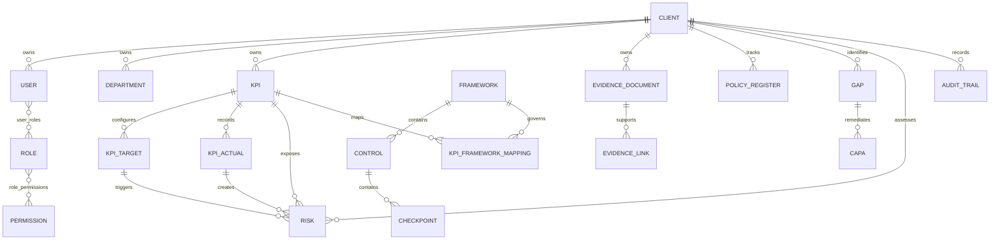

# Entity relationship overview

`EVIDENCE_LINK` targets KPI actuals, policy register entries, CAPA, gaps, checkpoints, risks, and future proof-bearing modules through a validated polymorphic reference.

The risk register classifies KPI-linked risks as major or minor. Frequency and unit of measure remain mastered on KPI so every target, actual, risk, and dashboard uses the same definition.
