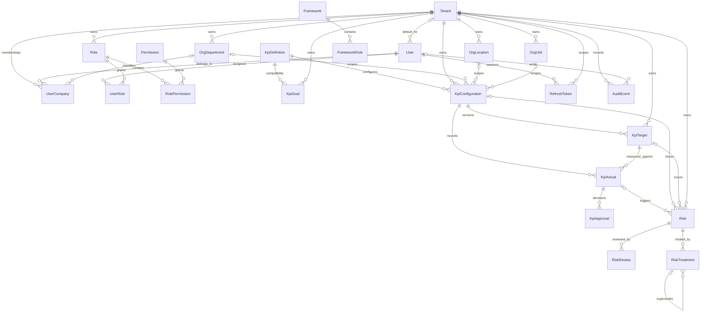

# Active entity relationship overview

This diagram reflects the 23 Prisma models. It intentionally excludes proposed
Policy, Control, Evidence, Gap, CAPA, Import, Task, Notification and Report
models because they are not implemented.

`KpiTarget` is authoritative. `KpiGoal` is compatibility data. Composite tenant
foreign keys, checks and triggers are detailed in
[constraints-and-triggers.md](./database/constraints-and-triggers.md).
