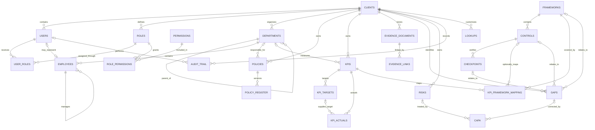
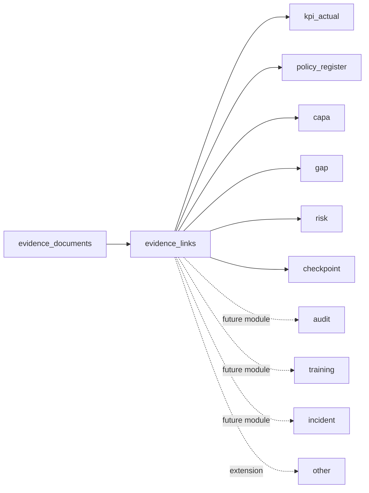

# GenBioCa GRC Entity Relationship Guide

This document explains the database relationships used by the GenBioCa GRC and KPI Compliance Management Platform. The physical definitions are in [`app/models/models.py`](app/models/models.py).

## Tenant boundary

`clients` is the tenant root. Every client-owned record carries `client_id`, and API requests derive that value from the authenticated JWT rather than accepting it from request bodies.

The following are global catalog tables shared read-only across clients:

- `frameworks`
- `controls`
- `checkpoints`
- `permissions`

All other operational tables are tenant-owned. Composite foreign keys include both `client_id` and the referenced record ID, preventing a record from client A from referencing a tenant-owned record from client B.

## Evidence relationships

`evidence_links` is deliberately polymorphic. It stores `entity_type` and `entity_id` instead of adding a separate evidence foreign key to every business table.

The API validates the tenant and target for modules that currently exist. `audit`, `training`, and `incident` are reserved for future business-module tables; `audit` does not refer to the immutable `audit_trail` log.

Only an active evidence document with `approval_status = approved` and an active evidence link satisfies a proof requirement.

## Core workflow relationships

### Policy workflow

`policies` is the policy master. `policy_register` stores versions and approval/review state. A register record cannot transition to approved, reviewed, or closed through the API unless approved evidence is linked to that exact register ID.

### KPI workflow

`kpis` is the master record. `kpi_targets` stores period targets, and `kpi_actuals` stores actual values and a copied target value for reporting history. An actual can optionally reference its target; a composite constraint guarantees that the target belongs to the same client and KPI.

When `use_in_scope` becomes false, `enabled` is automatically set to false. The database also rejects `enabled = true` when `use_in_scope = false`.

### Gap and CAPA workflow

A gap may point to a framework, control, and checkpoint. Constraints ensure that the control belongs to the framework and the checkpoint belongs to both. CAPA may originate from a gap or risk. Closing a gap or completing/closing a CAPA requires approved linked evidence.

## Framework scope

Frameworks are global reference data, but a client's active framework count is derived from that client's active KPI framework mappings. The count includes only the nine allowlisted frameworks and only mappings attached to enabled, in-scope KPIs.

GDPR, SOC variants, ADA, A11Y, and WCAG cannot appear in active mappings or dashboard framework counts. Historical rows are marked `not_in_current_scope`.
